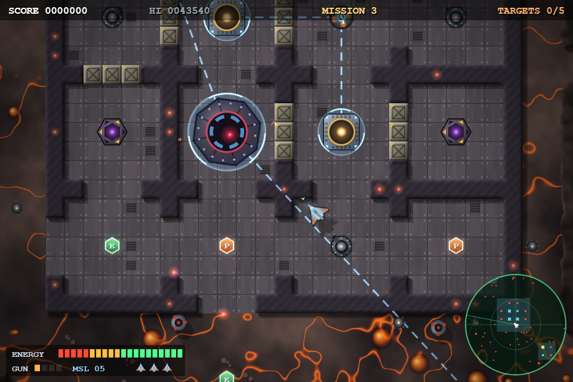
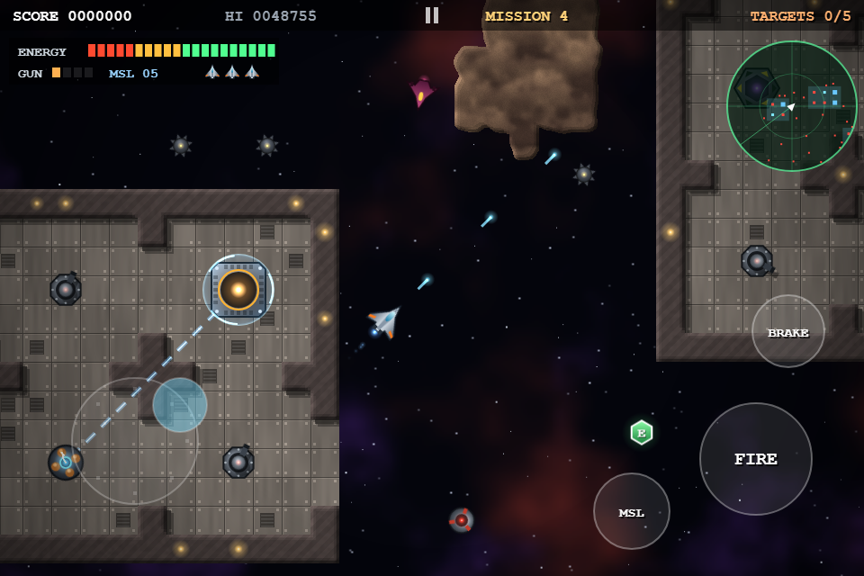
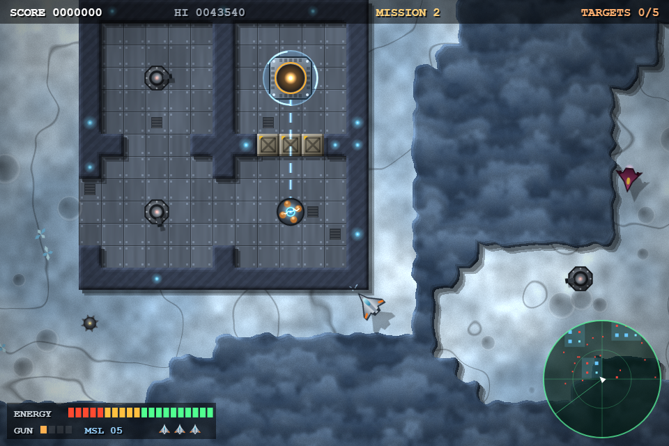
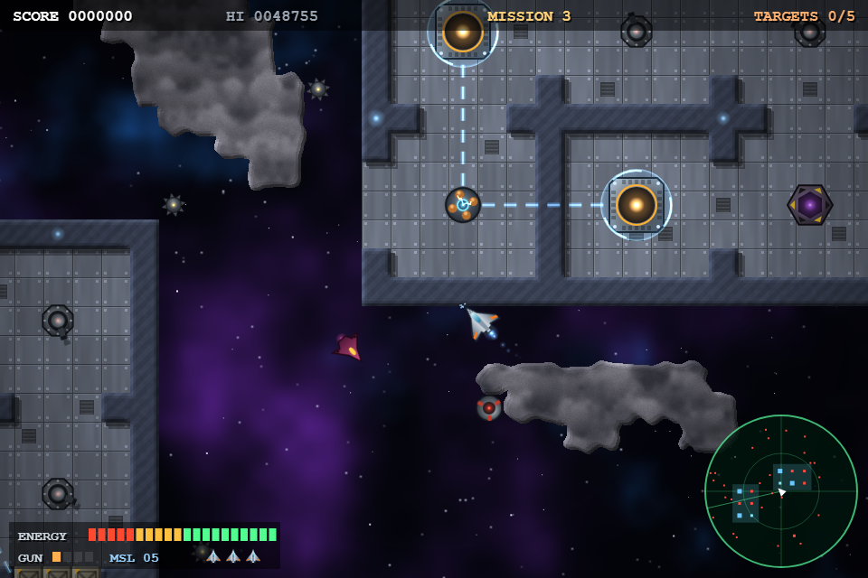
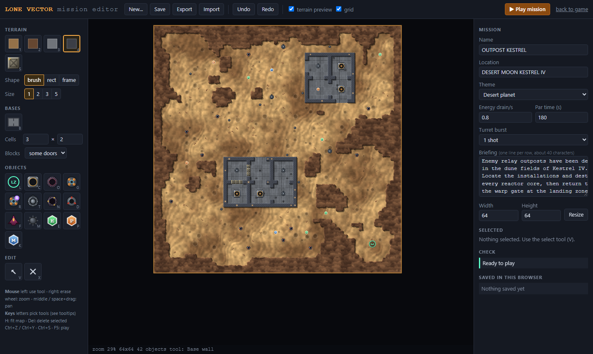
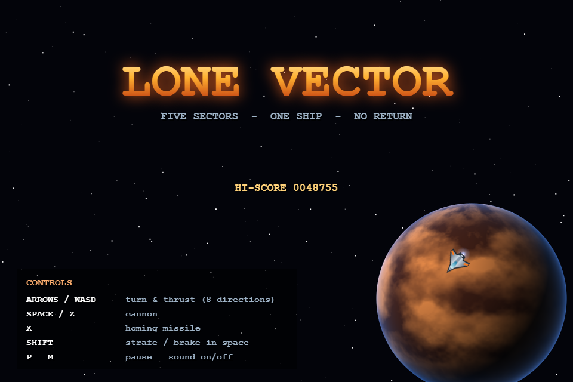

# Lone Vector

A top-down arcade shooter for the browser, inspired by **Last Mission** (Data East, 1986).
Fly a lone fighter over hostile worlds, find the walled enemy installations, and destroy
their reactor cores before your energy runs out.



This is an unofficial fan project. It is not affiliated with or endorsed by Data East or the
current rights holders of Last Mission. All graphics and sounds are generated in code. The
game uses no image or audio files.

## Play

The game is plain HTML5 canvas and JavaScript, with no build step.

- **Online:** https://mykkro.github.io/lone-vector/ (the mission editor is at `editor.html`).
- **No server needed:** open `public/index.html` in a browser.
- **With the bundled server:** run `npm install`, then `npm start`, then open http://localhost:3000.

### Deploy to GitHub Pages

The workflow in `.github/workflows/pages.yml` publishes `public/` (the game and the mission editor)
on every push to `main` or `master`.

1. Create a repository on GitHub and push this project to it:
   ```sh
   git remote add origin https://github.com/<you>/<repo>.git
   git push -u origin master
   ```
2. On GitHub, go to **Settings → Pages → Build and deployment** and set **Source** to **GitHub Actions**.
3. Re-run the workflow, or push again. The game will be at `https://<you>.github.io/<repo>/`.

You can also start a deploy by hand from the **Actions** tab ("Deploy to GitHub Pages" → *Run workflow*).

### Controls

| Key | Action |
| --- | --- |
| Arrows / WASD | turn and thrust. The ship turns through 8 headings toward the direction held |
| Space / Z | cannon (fires the way the ship faces) |
| X | homing missile |
| Shift | on planets: hold heading while moving (strafe). In space: brake |
| P / Esc | pause |
| M | sound on/off |
| Enter | start / continue |

### Mobile / touch

Play in landscape. On the first tap the game switches to touch controls and tries to go fullscreen.

- **Left half of the screen:** a floating joystick. Put your thumb down anywhere and drag. It snaps to the
  same 8 directions as the keyboard, and its base follows your thumb if you drag too far.
- **Right side:** a large **FIRE** button, plus **MSL** (missile) and **HOLD** (strafe). In space missions
  HOLD becomes **BRAKE**. You can hold several buttons at once.
- **Pause:** the **II** button in the top bar. Tap anywhere to get through menus.
- The energy gauge and radar move to the top of the screen so your thumbs don't cover them.



## Gameplay

- **Energy is everything.** As in the original, a single gauge serves as both fuel and shield. It drains
  all the time, and also when you take hits or crash into walls at speed. Collect **E** capsules to refill it.
- **Find the bases.** Installations are grids of walled cells joined by doorways. Some doorways are sealed
  with armored blocks you have to shoot through. The radar shows nearby structures. A target stays marked on the
  radar rim after you have seen it once.
- **Shields.** Shield generators protect reactor cores. Follow the energy conduits to the generators and take
  them out first, or your shots bounce off.
- **Get out.** When every target is destroyed, the warp gate at the landing zone opens. Fly back into it to finish
  the sector. You get bonuses for remaining energy and for time.
- **Power-ups:** **P** upgrades the cannon (4 levels), **M** adds homing missiles, **E** restores energy.
  Losing a ship costs one cannon level.

### Missions

| # | Sector | What's new |
| - | ------ | ---------- |
| 1 | Outpost Kestrel (desert moon) | two outposts, drones, turrets, mines |
| 2 | Cryo Relay (ice fields) | shield generators, fighters, drone spawners |
| 3 | Orbital Docks (space) | floating space stations among asteroids. The ship never stops |
| 4 | The Dark Belt (space) | fuel depots inside a dense asteroid belt |
| 5 | The Citadel (magma world) | remote generators shield the **Mothercore** boss |



### Space flight

Missions 3 and 4 take place in space. There is no ground to stop on, so the engines never cut out:

- With no input the ship holds a **cruise** speed.
- Holding a direction turns toward it and **boosts**.
- **Brake** (Shift, or the BRAKE button) slows to a crawl, which you need to slip through narrow station
  hatches. The ship never comes to a full stop.
- If you hit a hull or an asteroid, the ship ricochets off it and points along the bounce. Hitting it at
  speed still costs energy.



## Mission editor

Open **`editor.html`**, or use the "mission editor" link in the corner of the game page. The editor runs entirely
in the browser and needs no server.



- **Start** from a blank map, or have the editor generate one of the five campaign missions from any seed
  (**New...**). You can then reshape the result by hand.
- **Terrain:** paint ground or space, rock or asteroids, base floor, walls and destructible armored blocks.
  You can paint with a brush, a filled rectangle or a rectangle frame. Right-click paints empty ground.
- **Base stamp (B):** click to drop a walled grid of cells with random doors and entrances. You can set the
  number of cells and how many doorways get sealed with blocks.
- **Objects:** the landing zone (which is also the warp gate), reactor cores, the Mothercore, shield generators
  and remote generators, turrets, drone spawners, drones, fighters, mines, and E/P/M pickups. Right-click erases.
  The select tool (V) moves objects and edits their options.
- **Shields work the same way as in the game.** A generator shields every reactor core in the same base. A base
  is any connected group of floor and wall tiles. A *remote* generator shields the Mothercore. The editor draws
  dashed lines for these links.
- **Check panel:** lists problems such as no targets, a landing zone inside a wall, targets you can't reach, or
  a generator with nothing to shield. Click a problem to jump to it on the map.
- **Mission settings:** name, location, theme (three planets, two space themes), energy drain, par time, turret
  burst, briefing text and map size.
- **Play mission (F5):** runs the mission in the real game in an overlay. When you finish or die, Enter replays
  it. **Restart** sends your latest version. **Back to editor** returns to editing.
- **Saving:** **Save** keeps missions in the browser (listed on the right). The current draft is also kept
  automatically. **Export** and **Import** use `.lonevector.json` files. You can also drop an exported file onto
  the game page to play it.
- Undo/redo (Ctrl+Z / Ctrl+Y), zoom with the mouse wheel, pan with the middle button or Space+drag,
  H fits the map in view. Each tool has a one-letter shortcut, shown in its tooltip.

The mission file format is documented at the top of `public/js/game/Mission.js`.

## How it works

- **Levels** (`public/js/game/Level.js`) are generated from a fixed seed for each mission. Noise and a
  cellular automaton shape the rock formations. Grid installations are placed with a random spanning tree of
  doors, then winding canyons are carved from the landing zone, and a flood fill seals off unreachable pockets.
- **Terrain** (`Terrain.js`) is painted pixel by pixel from value noise into 512px chunk canvases. The rock
  and walls get bevel lighting and cast shadows. The chunks are rendered while the mission briefing is on screen.
  In space missions the open areas stay transparent over a parallax nebula and starfield.
- **Touch input** (`TouchPad.js`) turns the on-screen joystick and buttons into virtual key presses, so the game
  logic is the same for keyboard and touch.
- **Sprites** (`Gfx.js`) are drawn with canvas paths and gradients at startup. **Sound** (`Sfx.js`) is synthesized
  with WebAudio.
- **Missions** (`Mission.js`) are the shared file format. A level loads either from a seed (the campaign) or from
  a hand-made map (the editor). In a hand-made map, every connected group of floor and wall tiles counts as a base.



## License

The code is under the [MIT License](LICENSE). `public/js/Base.js` is by Dean Edwards and is also MIT licensed.
